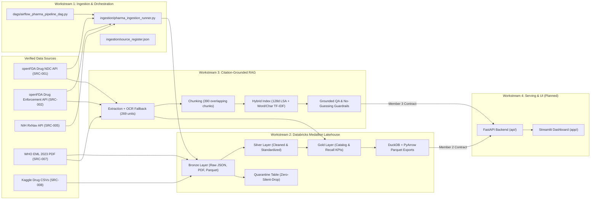

# Pharma Supply Chain Intelligence

An end-to-end **Data Engineering & Regulatory Intelligence** platform built with **Apache Airflow**, **Databricks Serverless Lakehouse (PySpark & Delta Lake)**, **DuckDB + PyArrow**, and a **Citation-Grounded Regulatory RAG Assistant** over official **U.S. FDA openFDA** datasets and the **WHO Model List of Essential Medicines (23rd List, 2023)**.

> [!IMPORTANT]
> **Data Governance & Zero-Mock Policy:** This system is an analytical decision-support tool for pharmaceutical procurement, supply-chain risk assessment, and regulatory lookup — not a clinical or diagnostic tool. Every metric, Delta table, and RAG response is grounded strictly in verified regulatory snapshots and documented source files. Live local Egyptian pharmacy stock levels and retail EGP pricing are **not** fabricated or mocked; out-of-scope queries are explicitly refused with `status: "no_answer"`.

---

## System Architecture



---

## Repository Structure

```text
pharma-supply-chain-intelligence/
├── README.md
├── requirements.txt                              # Python dependencies
├── .env.example                                  # Environment configuration template
├── dags/
│   └── airflow_pharma_pipeline_dag.py            # Apache Airflow DAG for Bronze API ingestion
├── ingestion/
│   ├── pharma_ingestion_runner.py                # Resilient HTTP ingestion runner with retries & metadata
│   └── source_register.json                      # Provenance & availability register (SRC-001..SRC-009)
├── lakehouse/
│   ├── schemas.json                              # Machine-readable Bronze/Silver/Gold schema contract
│   ├── DATA_DICTIONARY_LAKEHOUSE.md              # Full column-level Lakehouse data dictionary
│   ├── MEMBER_2_HANDOFF_CONTRACT.md              # DuckDB & PyArrow integration guide for Member 4
│   ├── bronze/
│   │   ├── 01_bronze_ingestion.ipynb             # Databricks notebook: raw Volume -> Bronze Delta tables
│   │   ├── bronze_openfda_ndc.parquet            # 100 FDA NDC product records
│   │   ├── bronze_openfda_enforcement.parquet    # 100 FDA recall enforcement records
│   │   ├── bronze_who_eml.parquet                # 69 WHO EML 2023 extracted pages
│   │   ├── bronze_storage_report.json            # Bronze storage audit report
│   │   ├── openfda_ndc_20261102T155044Z.json     # Raw openFDA NDC snapshot
│   │   ├── openfda_enforcement_20261102T155044Z.json # Raw openFDA Enforcement snapshot
│   │   ├── rxnav_version_20261102T155044Z.json   # Raw NIH RxNav version snapshot
│   │   ├── who/WHO_EML_2023.pdf                  # WHO Essential Medicines List (23rd List, 2023)
│   │   └── kaggle/                               # Supplementary Kaggle CSVs (22,145 rows)
│   ├── silver/
│   │   ├── 02_silver_cleaning_and_quarantine.ipynb # Databricks notebook: cleaning, WHO match & quarantine
│   │   ├── silver_openfda_ndc.parquet / .csv     # 97 validated NDC catalog records
│   │   ├── silver_openfda_enforcement.parquet / .csv # 100 validated recall records
│   │   ├── silver_quarantine_records.parquet / .csv  # 3 quarantined records with explicit reason codes
│   │   └── data_quality_report.json              # Silver DQ audit (98.5% pass rate, zero silent drops)
│   └── gold/
│       ├── 03_gold_analytics_and_duckdb_kpis.ipynb # Databricks notebook: Gold Delta tables + DuckDB KPIs
│       ├── gold_pharma_catalog_analytics.parquet / .csv # 88 active ingredients & supplier diversity
│       ├── gold_recall_supply_risk_kpis.parquet / .csv  # 17 hazard/root-cause recall risk segments
│       ├── gold_executive_kpis.json              # Pre-computed executive KPI summary
│       └── gold_rag_knowledge_corpus.csv         # Normalized text corpus for RAG
├── rag/
│   ├── MEMBER_3_HANDOFF_CONTRACT.md              # Python API & JSON schema contract for Member 4
│   ├── run_member3_pipeline.py                   # End-to-end RAG build & evaluation orchestrator
│   ├── interactive_demo.py                       # Terminal CLI for interactive free-text Q&A
│   ├── extraction/
│   │   ├── document_inventory.py                 # Source SHA-256 verification & register builder
│   │   ├── extractor.py                          # PDF + JSON extraction with baidu/Unlimited-OCR hook
│   │   ├── document_register.csv / .json         # Verified RAG source inventory
│   │   ├── extracted_documents.json              # 271 extracted units (269 usable)
│   │   └── extraction_report.json                # Extraction metrics report
│   ├── chunking/
│   │   ├── chunker.py                            # Overlapping chunker (1200 chars, 250 overlap)
│   │   ├── embeddings.py                         # Hybrid Word/Char TF-IDF + 128d SVD vector index
│   │   ├── chunks.json                           # 390 indexed chunks
│   │   ├── embeddings_matrix.npy                 # L2-normalized dense embeddings (390 x 128)
│   │   ├── vector_index.pkl                      # Fitted retrieval bundle
│   │   └── embeddings_report.json                # Index build audit
│   ├── retrieval/
│   │   └── rag_pipeline.py                       # ask_question() & retrieve_chunks() with guardrails
│   └── evaluation/
│       ├── evaluate_rag.py                       # 12-question retrieval & citation benchmark
│       ├── test_questions_bank.json              # Curated evaluation questions & guardrails
│       ├── rag_evaluation_report.json            # Detailed per-question evaluation JSON
│       └── RAG_EVALUATION_SUMMARY.md             # Evaluation metrics summary
├── api/                                          # FastAPI backend (Workstream 4 scaffolding)
├── app/                                          # Streamlit dashboard UI (Workstream 4 scaffolding)
├── docs/
│   └── data_dictionary.md                        # Medallion schema & quarantine rules reference
├── reports/
│   ├── DATA_CATALOG_DICTIONARY.md                # Catalog dictionary copy for reporting
│   └── data_quality_report.json                  # Data quality audit copy for reporting
├── data_samples/
│   └── raw_sample.csv                            # 10-row synthetic QA test fixture for edge cases
└── tests/
    ├── test_lakehouse_pipeline.py                # Automated pytest suite for Lakehouse & DuckDB
    └── test_rag_pipeline.py                      # Automated pytest suite for RAG & citations
```

---

## Data Sources & Provenance Register

Tracked in [`ingestion/source_register.json`](ingestion/source_register.json):

| Source ID | Source Name | Endpoint / File | Status & Scope |
|---|---|---|---|
| `SRC-001` | **openFDA Drug NDC** | `https://api.fda.gov/drug/ndc.json` | Verified API snapshot (`100` Bronze records in Lakehouse; `300` in full register check). Product directory only — does not imply live pharmacy stock. |
| `SRC-002` | **openFDA Drug Enforcement** | `https://api.fda.gov/drug/enforcement.json` | Verified API snapshot (`100` recall records in Lakehouse; `150` in full register check). U.S. FDA recall actions, classifications, and root causes. |
| `SRC-005` | **NIH RxNav** | `https://rxnav.nlm.nih.gov/REST/version.json` | Verified API connectivity and version/concept metadata (`rxnav_version_20261102T155044Z.json`). |
| `SRC-007` | **WHO Essential Medicines List (23rd List, 2023)** | `lakehouse/bronze/who/WHO_EML_2023.pdf` | Verified local official PDF (`71` pages total, `69` usable content pages extracted into `bronze_who_eml.parquet`). |
| `SRC-008` | **Kaggle Medicines Dataset** | `lakehouse/bronze/kaggle/medicine_data.csv` & `Medicine_Details.csv` | `22,145` supplementary reference rows stored in Bronze (INR market data; isolated from USD/EGP metrics). |
| `SRC-003` | openFDA Drug Shortages | `https://api.fda.gov/drug/shortages.json` | Returned `0` records (`COMPLETED_END_OF_API_DATA`). |
| `SRC-004` | FDA NDC Bulk Download | `drug-ndc-0001-of-0001.json` | Not downloaded locally (`FILE_NOT_FOUND`); API snapshot used instead. |
| `SRC-006` | Egyptian Drug Authority (EDA) Safety Alerts | `eda/eda_alerts_raw.json` | No local official PDF provided (`NO_LOCAL_PDF_PROVIDED`); no web scraping or mock data used. |
| `SRC-009` | Drugs.com Pricing Corpus | — | Marked `SOURCE_UNAVAILABLE_NO_MOCK_DATA` per Zero-Mock Policy. |

---

## Medallion Lakehouse & Data Quality (Workstream 2)

The Lakehouse runs on **Databricks Unity Catalog & Delta Lake** (`workspace.default.*`) via three Serverless notebooks and exports local **Parquet / CSV** snapshots for DuckDB analytics.

### Lakehouse Tables (`workspace.default`)

| Layer | Table Name | Primary Key | Row Count | Description |
|---|---|---|---:|---|
| **BRONZE** | `bronze_openfda_ndc` | `product_id` | 100 | Raw openFDA NDC records with ingestion metadata and `raw_record_sha256` lineage hash. |
| **BRONZE** | `bronze_openfda_enforcement` | `recall_number` | 100 | Raw openFDA Drug Enforcement recall reports with lineage metadata. |
| **BRONZE** | `bronze_who_eml` | `page_number` | 69 | Extracted text pages from WHO Model List of Essential Medicines (2023). |
| **SILVER** | `silver_openfda_ndc` | `product_id` | 97 | Cleaned, deduplicated NDC catalog with flattened active ingredients, ISO dates, and WHO EML match flag. |
| **SILVER** | `silver_openfda_enforcement` | `recall_number` | 100 | Standardized recall reports with `severity_rank`, ISO dates, `recall_year`, and categorized root causes. |
| **QUARANTINE** | `silver_quarantine_records` | `quarantine_id` | 3 | Rejected Bronze records preserved with explicit `quarantine_reason_code` and raw JSON payload. |
| **GOLD** | `gold_pharma_catalog_analytics` | `active_ingredient` | 88 | Active ingredient supply-chain diversity, `single_supplier_risk`, dosage forms, and `is_who_essential`. |
| **GOLD** | `gold_recall_supply_risk_kpis` | `risk_segment_id` | 17 | Aggregated recall counts (ongoing vs. closed) by hazard class, root-cause bucket, and country. |

### Data Quality & Executive KPI Highlights

From [`lakehouse/silver/data_quality_report.json`](lakehouse/silver/data_quality_report.json) and [`lakehouse/gold/gold_executive_kpis.json`](lakehouse/gold/gold_executive_kpis.json):

- **Zero-Silent-Drop Policy Verified (`true`):** `200` Bronze FDA records evaluated → `197` valid Silver records + `3` quarantined records = `200` accounted for (**98.5% pass rate**). All `3` quarantined NDC records (`Q-NDC-0001`..`Q-NDC-0003`) failed rule `MISSING_ACTIVE_INGREDIENT_OR_STRENGTH`.
- **Catalog Supply Concentration:** `88` distinct active ingredients across `97` validated NDC products; `83` ingredients (**94.32%**) rely on a single labeler/manufacturer in the snapshot; `35` ingredients match the WHO Essential Medicines List (2023).
- **Recall Risk Breakdown:** `100` validated recalls across `79` distinct firms (`8` Class I high hazard, `84` Class II moderate hazard, `8` Class III low hazard; `15` currently `Ongoing`). Top root-cause categories: **Sterility Failure (`38%`)**, **CGMP Deviation (`19%`)**, and **Contamination or Impurity (`18%`)**.

---

## Citation-Grounded Regulatory RAG Pipeline (Workstream 3)

Implemented as a 5-stage deterministic pipeline orchestrated by [`rag/run_member3_pipeline.py`](rag/run_member3_pipeline.py):

1. **Inventory & Provenance ([`document_inventory.py`](rag/extraction/document_inventory.py)):** Verifies file presence, SHA-256 checksums, licenses, and geographic scope limitations for `3` official sources (`DOC-WHO-EML-2023`, `DOC-FDA-ENF-20261102`, `DOC-FDA-NDC-20261102`).
2. **Extraction & OCR Fallback ([`extractor.py`](rag/extraction/extractor.py)):** Extracts `271` units (`269` usable, `286,772` characters), triggering the `baidu/Unlimited-OCR` fallback hook only on low-text/cover PDF pages (`2` pages in WHO EML 2023), and outputs [`lakehouse/gold/gold_rag_knowledge_corpus.csv`](lakehouse/gold/gold_rag_knowledge_corpus.csv).
3. **Chunking ([`chunker.py`](rag/chunking/chunker.py)):** Splits the `269` usable units into `390` overlapping chunks (`1,200` chars max, `250` char overlap, averaging `817.5` chars/chunk).
4. **Hybrid Indexing ([`embeddings.py`](rag/chunking/embeddings.py)):** Builds `sklearn-hybrid-lsa-128d` combining Word n-gram TF-IDF (`1–2`), Character n-gram TF-IDF (`3–5`), and L2-normalized `128`-dim `TruncatedSVD` dense embeddings (`embeddings_matrix.npy`, `vector_index.pkl`).
5. **Retrieval & Guardrails ([`rag_pipeline.py`](rag/retrieval/rag_pipeline.py)):** Combines hybrid similarity with IDF-weighted entity overlap and intent boosts. Queries asking for live Egyptian pharmacy inventory or EGP retail pricing are intercepted and rejected with `status: "no_answer"`.

### RAG Evaluation Benchmark

Measured across the 12-question benchmark in [`rag/evaluation/RAG_EVALUATION_SUMMARY.md`](rag/evaluation/RAG_EVALUATION_SUMMARY.md):

| Evaluation Metric | Score |
|---|---:|
| Overall Status Accuracy (`answered` vs `no_answer`) | **100.0%** (12/12) |
| Document Retrieval Hit@1 | **100.0%** (9/9) |
| Document Retrieval Hit@3 | **100.0%** (9/9) |
| Exact Page/Record Citation Accuracy | **100.0%** (9/9) |
| Evidence Keyword Support Rate | **100.0%** (9/9) |
| Unsupported Query Rejection Rate (No-Guessing Guardrail) | **100.0%** (3/3) |

---

## Integration Contracts (DuckDB Analytics & RAG API)

### 1. Querying Gold & Silver Parquet Tables (Member 2 → Member 4)

See [`lakehouse/MEMBER_2_HANDOFF_CONTRACT.md`](lakehouse/MEMBER_2_HANDOFF_CONTRACT.md):

```python
import duckdb
import pyarrow.parquet as pq

con = duckdb.connect(database=":memory:")
con.register("gold_catalog", pq.read_table("lakehouse/gold/gold_pharma_catalog_analytics.parquet"))
con.register("gold_recalls", pq.read_table("lakehouse/gold/gold_recall_supply_risk_kpis.parquet"))

top_ingredients = con.execute("""
    SELECT active_ingredient, total_products, distinct_labelers_count, is_who_essential
    FROM gold_catalog
    ORDER BY total_products DESC
    LIMIT 10
""").df()
```

### 2. Querying the Citation-Grounded RAG Pipeline (Member 3 → Member 4)

See [`rag/MEMBER_3_HANDOFF_CONTRACT.md`](rag/MEMBER_3_HANDOFF_CONTRACT.md):

```python
from rag.retrieval import ask_question, retrieve_chunks

response = ask_question(
    query="What caused the recall of Progesterone 100 mg/mL in Corn Oil Injection (D-321-2016)?",
    top_k=3,
    min_score=0.25,
)
# Returns: {"query", "status", "answer", "confidence_score", "scope_disclaimer", "sources": [...]}

chunks = retrieve_chunks(
    query="amoxicillin community acquired pneumonia",
    top_k=4,
    document_type_filter="PDF_REGULATORY_GUIDELINE",
)
```

---

## Quickstart, Execution & Testing

### 1. Local Environment Setup

```bash
python -m venv .venv
source .venv/bin/activate        # Windows PowerShell: .\.venv\Scripts\Activate.ps1
pip install -r requirements.txt
cp .env.example .env             # Windows: copy .env.example .env
```

### 2. Run Bronze API Ingestion (Workstream 1)

```bash
python ingestion/pharma_ingestion_runner.py
```

For orchestrated scheduling, load [`dags/airflow_pharma_pipeline_dag.py`](dags/airflow_pharma_pipeline_dag.py) (`dag_id: pharma_supply_chain_ingestion`) in Apache Airflow.

### 3. Run Databricks Serverless Lakehouse Workflow (Workstream 2)

The 3-stage Medallion workflow runs on **Databricks Serverless** using input Unity Catalog Volume `/Volumes/workspace/default/raw_data`:

1. `01_bronze_ingestion` — Reads raw openFDA JSONs & WHO EML snapshot into `workspace.default.bronze_*` Delta tables.
2. `02_silver_cleaning_and_quarantine` — Applies ANSI-safe `try_to_date`, deduplication, WHO EML cross-matching, and Zero-Silent-Drop quarantine into `workspace.default.silver_*`.
3. `03_gold_analytics_and_duckdb_kpis` — Builds `workspace.default.gold_*` Delta tables and runs DuckDB + PyArrow KPI analytics (configured with `duckdb==1.3.2` in the Serverless job environment).

To trigger the deployed Lakeflow Job from the Databricks CLI:

```bash
databricks jobs run-now <JOB_ID> --profile <PROFILE>
```

### 4. Run the RAG Pipeline & Interactive CLI Demo (Workstream 3)

```bash
# Rebuild inventory, extraction, chunks, embeddings, and 12-question evaluation
python rag/run_member3_pipeline.py

# Launch interactive free-text Q&A in the terminal
python rag/interactive_demo.py
```

### 5. Run Automated Tests

```bash
pytest tests/test_lakehouse_pipeline.py tests/test_rag_pipeline.py -v
```

---

## Team Responsibilities, Documentation & Milestones

### Team Ownership

| Workstream | Owner | Responsibilities | Key Paths |
|---|---|---|---|
| **Member 1: Ingestion & Airflow** | Mohamed Nasr | Source register, resilient API connectors, Airflow DAG, raw Bronze snapshots | `dags/`, `ingestion/` |
| **Member 2: Lakehouse & Data Quality** | Ahmed Essam | Medallion schema design, Databricks Bronze/Silver/Gold notebooks, quarantine enforcement, DuckDB KPIs | `lakehouse/`, `docs/`, `reports/`, `tests/test_lakehouse_pipeline.py` |
| **Member 3: Documents & RAG** | Mayar Hany | Document inventory, PDF/JSON extraction & OCR fallback, chunking, 128d LSA hybrid index, grounded citations & evaluation | `rag/`, `tests/test_rag_pipeline.py` |
| **Member 4: API, UI & Integration** | Rawan Husseiny | FastAPI endpoints, Streamlit dashboard, end-to-end integration & demo | `api/`, `app/` |

### Documentation Index

- [`lakehouse/DATA_DICTIONARY_LAKEHOUSE.md`](lakehouse/DATA_DICTIONARY_LAKEHOUSE.md) — Column-level Lakehouse table & type specification
- [`lakehouse/MEMBER_2_HANDOFF_CONTRACT.md`](lakehouse/MEMBER_2_HANDOFF_CONTRACT.md) — DuckDB + PyArrow query contract
- [`rag/MEMBER_3_HANDOFF_CONTRACT.md`](rag/MEMBER_3_HANDOFF_CONTRACT.md) — RAG Python interface & JSON response schemas
- [`rag/evaluation/RAG_EVALUATION_SUMMARY.md`](rag/evaluation/RAG_EVALUATION_SUMMARY.md) — Retrieval & citation accuracy benchmark
- [`docs/data_dictionary.md`](docs/data_dictionary.md) — Project-wide Medallion & quarantine rules reference

### Delivery Milestones & Git Workflow

- **Oct 16:** Planning, Requirements & Literature Review
- **Nov 6:** System Analysis & Design (Architecture, Data Model, Test Plan)
- **Nov 30:** Implementation (Pipelines, Delta Lakehouse, RAG, FastAPI & Streamlit UI)
- **Dec 4:** Final Testing, Report & Live Demo

**Git Conventions:** Develop on feature branches (`feature/<scope>`), never commit `.env` credentials or unverified mock data, and run `pytest` before opening a Pull Request.
